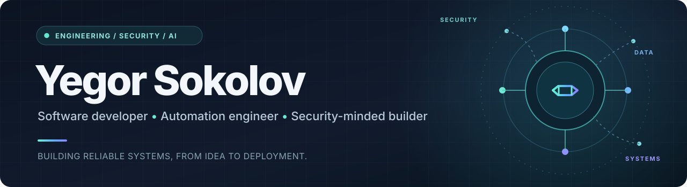

<!-- Profile landing page: project status reflects public repository documentation. -->

  <strong>I build reliable software, automation, and security-focused tools.</strong> 
  Honours Computer Science at York University · Quality Assurance Analyst at Tacit Innovations

  <a href="#selected-projects">Featured projects</a> ·
  <a href="#engineering-impact">Engineering impact</a> ·
  <a href="#technical-toolkit">Tech stack</a> ·
  <a href="#connect">Connect</a>

  
  
  
  

## About me

I'm a computer science student and QA professional with hands-on experience testing production software, improving release confidence, and building automation. My projects span **Java applications, Python services, security investigation tooling, machine-learning research pipelines, and test infrastructure**.

I care about **systems that are observable, testable, and dependable**—not just polished demos.

## Selected projects

<table>
<tr>
<td width="50%" valign="top">
<h3>🛡️ <a href="https://github.com/yegorsokolov/eecs3311-sentinel">Sentinel</a></h3>

<strong>Cybersecurity incident triage · In development</strong>

Java investigation workbench with validated, versioned JSON imports; bounded tool sessions; evidence-aware log search; account activity analysis; and local indicator lookup. End-to-end agent orchestration and the GUI are still in progress.

<code>Java</code> <code>Maven</code> <code>JUnit</code> <code>Security</code>

<a href="https://github.com/yegorsokolov/eecs3311-sentinel">Explore repository →</a>
</td>
<td width="50%" valign="top">
<h3>📈 <a href="https://github.com/yegorsokolov/MT5">Adaptive MT5 Research Platform</a></h3>

<strong>Machine learning and data engineering · Research toolkit</strong>

Python tooling for historical market data, feature engineering, model training, backtesting, and configurable risk controls, including Linux/Wine integration with MetaTrader 5.

<code>Python</code> <code>ML</code> <code>Docker</code> <code>Linux</code>

<a href="https://github.com/yegorsokolov/MT5">Explore repository →</a>
</td>
</tr>
<tr>
<td width="50%" valign="top">
<h3>⚙️ <a href="https://github.com/yegorsokolov/BotCopier">BotCopier</a></h3>

<strong>Model evaluation and deployment utilities</strong>

Python CLI for training and evaluating models on time-series trade logs, with model-distillation tools that export lightweight models for MQL4 workflows.

<code>Python</code> <code>Typer</code> <code>scikit-learn</code> <code>Pytest</code>

<a href="https://github.com/yegorsokolov/BotCopier">Explore repository →</a>
</td>
<td width="50%" valign="top">
<h3>🎵 <a href="https://github.com/yegorsokolov/SpotifyFunctions">SpotifyFunctions</a></h3>

<strong>Web application and practical automation</strong>

Flask-based collection of Spotify utilities for playlist shrinking, recovery, cleanup, and reordering.

<code>Python</code> <code>Flask</code> <code>Web</code> <code>Automation</code>

<a href="https://github.com/yegorsokolov/SpotifyFunctions">Explore repository →</a>
</td>
</tr>
</table>

Also exploring <a href="https://github.com/yegorsokolov/eecs4414-project">network science and conflict cascades in Reddit communities</a> (group coursework), alongside <a href="https://github.com/yegorsokolov/Portfolio">smaller automation projects</a>.

## Engineering impact

Highlights from professional quality engineering work; these are not results attributed to the public projects above.

<table>
<tr>
<td align="center" width="33%"><h2>500+</h2><strong>Test cases</strong> designed and executed</td>
<td align="center" width="33%"><h2>40+</h2><strong>Automated smoke tests</strong> release verification</td>
<td align="center" width="34%"><h2>~40 hrs/month</h2><strong>Time saved</strong> through GA4 / Playwright automation</td>
</tr>
</table>

My quality engineering toolkit includes **Jenkins, Jira, MySQL, Playwright, GitHub Actions, Wireshark, and Zephyr Scale**.

## Technical toolkit

**Languages & backend**

**Quality, delivery & infrastructure**

**Security, data & machine learning**

## How I work

- **Build with evidence:** reproducible runs, explicit assumptions, and observable behavior.
- **Design for failure:** tests, bounded operations, recovery paths, and risk-aware controls.
- **Ship iteratively:** working components first; clearly distinguish implemented and planned features.

## Connect

I'm interested in **early-career software engineering, security engineering, QA automation, and data-focused roles**, especially where reliability and systems thinking matter. Explore the linked repositories and reach out through [GitHub](https://github.com/yegorsokolov).

Professional contact or LinkedIn link can be added here later.
